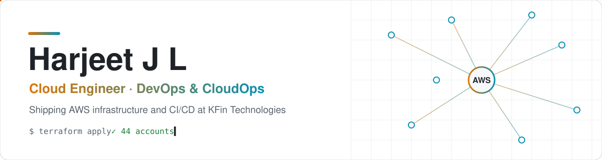
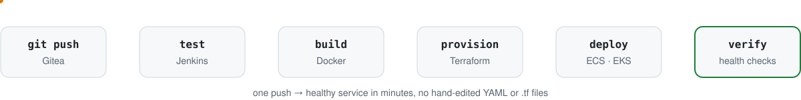
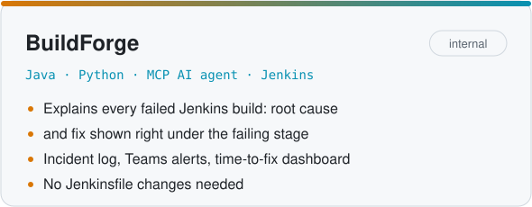
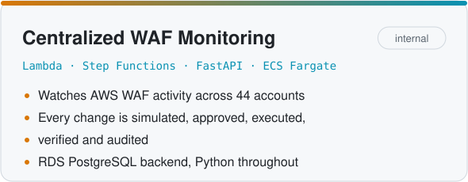

<picture>
  <source media="(prefers-color-scheme: dark)" srcset="assets/banner-dark.svg">
  
</picture>

  
  
  
  

Cloud Engineer at **KFin Technologies**, working on DevOps and CloudOps for a regulated
financial-services platform on AWS. I turn manual release and provisioning work into
self-service automation: Jenkins pipelines, dynamic Terraform, containers on ECS and EKS,
and the internal tools that keep them healthy. I'm also on the 24/7 production support team.

## Impact

<picture>
  <source media="(prefers-color-scheme: dark)" srcset="assets/impact-dark.svg">
  
</picture>

## How I ship

<picture>
  <source media="(prefers-color-scheme: dark)" srcset="assets/pipeline-dark.svg">
  
</picture>

Every application gets its own Jenkins pipeline wired to Gitea: tests on every push, Docker
images built and pushed, ECS task definitions and services updated, and the rollout watched
until it is healthy. Infrastructure comes from Terraform modules parameterized from Jenkins,
so teams create resources without touching YAML or `.tf` files.

## What I've built

<picture>
  <source media="(prefers-color-scheme: dark)" srcset="assets/project-buildforge-dark.svg">
  
</picture>
<picture>
  <source media="(prefers-color-scheme: dark)" srcset="assets/project-waf-platform-dark.svg">
  
</picture>

Both are internal tools at KFin, so the code isn't public. Open source work:

| Project | About |
|---|---|
| [Hukum-AI-Video-Editor](https://github.com/Harjeet2411/Hukum-AI-Video-Editor) | AI-assisted video editor |
| [Capstone-Devops](https://github.com/Harjeet2411/Capstone-Devops) | DevOps capstone: pipeline, containers and infrastructure end to end |
| [DSA-Visualizer](https://github.com/Harjeet2411/DSA-Visualizer) | Interactive data structures and algorithms visualizer |
| [Mouse-Gestures-with-OpenCV](https://github.com/Harjeet2411/Mouse-Gestures-with-Open-Cv-Hand-Gestures-) | Control the mouse with hand gestures using OpenCV |
| [ARQE-Flutter-App](https://github.com/Harjeet2411/ARQE-Flutter-App) | Flutter mobile app |

## Toolbox

**Cloud** &nbsp;

**IaC & CI/CD** &nbsp;

**Containers & ops** &nbsp;

**Code** &nbsp;

## On GitHub

<table>
  <tr>
    <td width="50%">
      <picture>
        <source media="(prefers-color-scheme: dark)" srcset="https://raw.githubusercontent.com/Harjeet2411/Harjeet2411/output/stats-dark.svg">
        
      </picture>
    </td>
    <td width="50%">
      <picture>
        <source media="(prefers-color-scheme: dark)" srcset="https://raw.githubusercontent.com/Harjeet2411/Harjeet2411/output/languages-dark.svg">
        
      </picture>
    </td>
  </tr>
</table>

<picture>
  <source media="(prefers-color-scheme: dark)" srcset="https://raw.githubusercontent.com/Harjeet2411/Harjeet2411/output/snake-dark.svg">
  
</picture>

### Recently

<!-- ACTIVITY:START -->
- Building BuildForge, an AI failure-analysis plugin for Jenkins
- Working on EaseMySSH and the centralized WAF monitoring platform
<!-- ACTIVITY:END -->

### Weekly build

<!-- WEEKLY:START -->
Every week I ship a small open-source DevSecOps tool. The first one is a WAF audit-log analyzer.
<!-- WEEKLY:END -->

---

B.Tech CSE (AI &amp; ML), SRIHER Chennai · AWS Academy Cloud Foundations and ML Foundations 
Cards are generated daily by <a href=".github/workflows/profile.yml">a workflow in this repo</a>.

