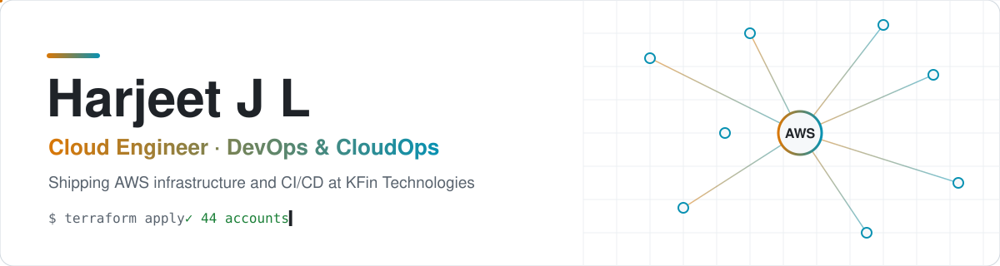
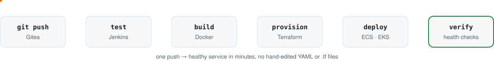
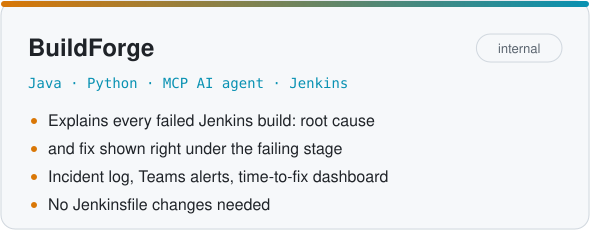
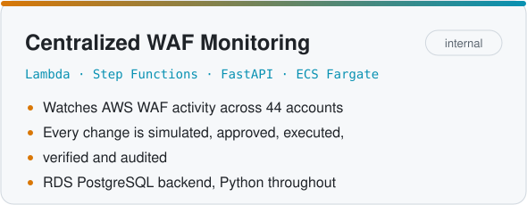
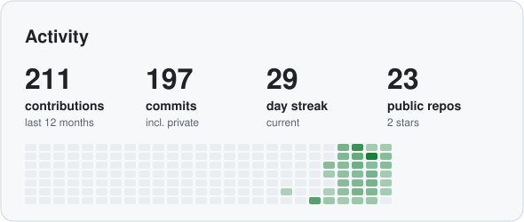
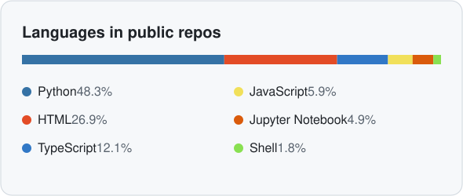

<picture>
  <source media="(prefers-color-scheme: dark)" srcset="assets/banner-dark.svg">
  
</picture>

  
  
  
  

Cloud Engineer at **KFin Technologies**, working on DevOps and CloudOps for a regulated
financial-services platform on AWS. I turn manual release and provisioning work into
self-service automation: Jenkins pipelines, dynamic Terraform, containers on ECS and EKS,
and the internal tools that keep them healthy. I'm also on the 24/7 production support team.

## Impact

<picture>
  <source media="(prefers-color-scheme: dark)" srcset="assets/impact-dark.svg">
  
</picture>

## How I ship

<picture>
  <source media="(prefers-color-scheme: dark)" srcset="assets/pipeline-dark.svg">
  
</picture>

Every application gets its own Jenkins pipeline wired to Gitea: tests on every push, Docker
images built and pushed, ECS task definitions and services updated, and the rollout watched
until it is healthy. Infrastructure comes from Terraform modules parameterized from Jenkins,
so teams create resources without touching YAML or `.tf` files.

## What I've built

<picture>
  <source media="(prefers-color-scheme: dark)" srcset="assets/project-buildforge-dark.svg">
  
</picture>
<picture>
  <source media="(prefers-color-scheme: dark)" srcset="assets/project-waf-platform-dark.svg">
  
</picture>

Both are internal tools at KFin, so the code isn't public. Open source work:

| Project | About |
|---|---|
| [harjeetjl-portfolio](https://github.com/Harjeet2411/harjeetjl-portfolio) | My interactive 3D portfolio, [live on GitHub Pages](https://harjeet2411.github.io/harjeetjl-portfolio/) |
| [gha-pinner](https://github.com/Harjeet2411/gha-pinner) | Pins GitHub Actions to commit SHAs and fails CI when one is left on a movable tag |
| [cert-watch](https://github.com/Harjeet2411/cert-watch) | Checks TLS certificate expiry, weak ciphers and old TLS versions for a list of hosts and exits non-zero so CI can fail before a certificate lapses |
| [tf-drift-report](https://github.com/Harjeet2411/tf-drift-report) | Turns `terraform show -json` plan output into a short drift report, with destroys and replaces listed first and sensitive values never printed |
| [k8s-cost-peek](https://github.com/Harjeet2411/k8s-cost-peek) | Prices Kubernetes CPU and memory requests per namespace or team from `kubectl` output, with a CI budget check |
| [dockerfile-doctor](https://github.com/Harjeet2411/dockerfile-doctor) | Dockerfile security and image-size linter with fix suggestions and SARIF output |
| [waflens](https://github.com/Harjeet2411/waflens) | Summarises ModSecurity/Coraza WAF audit logs and flags likely false positives |
| [Rag-Api-with-FAST-API](https://github.com/Harjeet2411/Rag-Api-with-FAST-API) | RAG API over my profile: ChromaDB retrieval, local Ollama model, FastAPI endpoints with multi-user documents |
| [Rag-Api-Ollama](https://github.com/Harjeet2411/Rag-Api-Ollama) | Run LLMs locally with Ollama, plus a custom coding-tutor model built from a Modelfile |
| [Hukum-AI-Video-Editor](https://github.com/Harjeet2411/Hukum-AI-Video-Editor) | AI-assisted video editor |
| [Capstone-Devops](https://github.com/Harjeet2411/Capstone-Devops) | DevOps capstone: pipeline, containers and infrastructure end to end |
| [DSA-Visualizer](https://github.com/Harjeet2411/DSA-Visualizer) | Interactive data structures and algorithms visualizer |
| [Mouse-Gestures-with-OpenCV](https://github.com/Harjeet2411/Mouse-Gestures-with-Open-Cv-Hand-Gestures-) | Control the mouse with hand gestures using OpenCV |
| [ARQE-Flutter-App](https://github.com/Harjeet2411/ARQE-Flutter-App) | Flutter mobile app |

## Toolbox

**Cloud** &nbsp;

**IaC & CI/CD** &nbsp;

**Containers & ops** &nbsp;

**Code** &nbsp;

## On GitHub

<table>
  <tr>
    <td width="50%">
      <picture>
        <source media="(prefers-color-scheme: dark)" srcset="https://raw.githubusercontent.com/Harjeet2411/Harjeet2411/output/stats-dark.svg">
        
      </picture>
    </td>
    <td width="50%">
      <picture>
        <source media="(prefers-color-scheme: dark)" srcset="https://raw.githubusercontent.com/Harjeet2411/Harjeet2411/output/languages-dark.svg">
        
      </picture>
    </td>
  </tr>
</table>

<picture>
  <source media="(prefers-color-scheme: dark)" srcset="https://raw.githubusercontent.com/Harjeet2411/Harjeet2411/output/snake-dark.svg">
  
</picture>

### Recently

<!-- ACTIVITY:START -->
**Week of 23 Nov 2026**
- Built cert-watch, the sixth weekly tool: checks TLS certificate expiry for a list of hosts, flags refused certificates, weak ciphers and servers that still accept TLS 1.0 or 1.1, and exits non-zero so CI can fail before a certificate lapses. It is now published as [cert-watch](https://github.com/Harjeet2411/cert-watch).

**Week of 16 Nov 2026**
- Built tf-drift-report, the fifth weekly tool: turns `terraform show -json` plan output into a short drift report (text or a Markdown pull request comment), lists what will be destroyed or replaced with databases and buckets first, never prints sensitive values and can fail CI on drift or destroys. It is now published as [tf-drift-report](https://github.com/Harjeet2411/tf-drift-report).
- The algorithm visualizer's interactive canvas now redraws when its edges change, and three unused dependencies (zod, react-query, hookform resolvers) were removed. EaseMySSH shows an error instead of failing silently when Edit servers, Reload or Logs cannot run, and its CI workflow pins its actions to commit SHAs.
- The algorithm visualizer lost over 1,300 lines of unused components, got `typecheck` and `lint` scripts, and its learning roadmap no longer rebuilds its static algorithm lists on every render. EaseMySSH now disposes the graphics objects behind its tray icons and shares one tooltip across rows instead of making one per row on every reload.
- The algorithm visualizer's graph canvas now redraws when its size changes, and its algorithm runner resets on a stable dependency list instead of an incomplete one.
- The algorithm visualizer's graph pages now number their exploration steps from the latest list, so a stale render can no longer repeat a step number.

<!-- ACTIVITY:END -->

### Weekly build

<!-- WEEKLY:START -->
Every week I build a small open-source DevSecOps tool. Shipped so far: [waflens](https://github.com/Harjeet2411/waflens) (WAF audit-log analyzer that flags likely false positives), [dockerfile-doctor](https://github.com/Harjeet2411/dockerfile-doctor) (Dockerfile security and image-size linter), [k8s-cost-peek](https://github.com/Harjeet2411/k8s-cost-peek) (Kubernetes request costs per namespace or team) and [gha-pinner](https://github.com/Harjeet2411/gha-pinner) (pins GitHub Actions to commit SHAs) [tf-drift-report](https://github.com/Harjeet2411/tf-drift-report) (Terraform plan drift summary) and [cert-watch](https://github.com/Harjeet2411/cert-watch) (TLS certificate expiry checks).
<!-- WEEKLY:END -->

---

B.Tech CSE (AI &amp; ML), SRIHER Chennai · AWS Academy Cloud Foundations and ML Foundations 
Cards are generated daily by <a href=".github/workflows/profile.yml">a workflow in this repo</a>.

